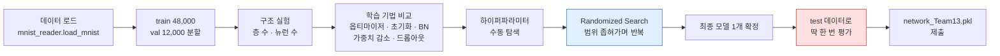
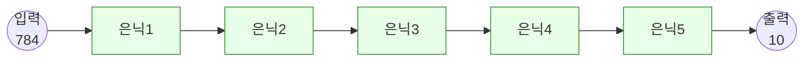
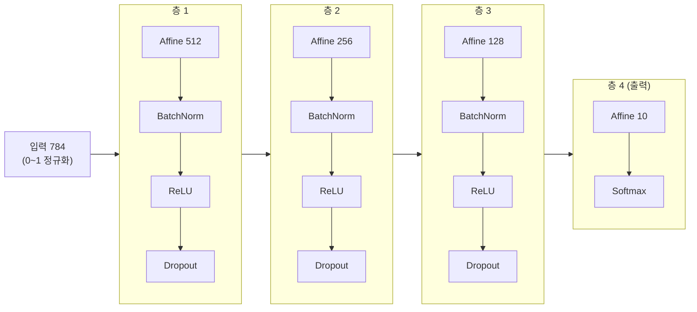
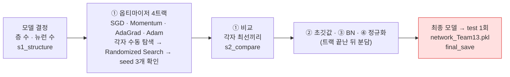
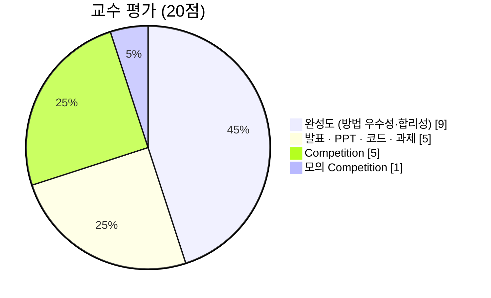

# 우리들의 신경망 모델

**2026 신경망 팀플 · Fashion-MNIST 분류**

### 목표
수업에서 배운 신경망 방법으로 **"우리들의 신경망 모델"** 을 만든다.
목표를 이루기 위해 일정을 관리하고, 동료와 협업하고 배려하며, 성취감을 느낀다.

### 팀플 개요
- 팀별로 협력하여 주어진 연구를 수행한다.
- **Fashion-MNIST** 데이터셋에 수업에서 배운 학습 방법을 적용해 **최선의 분류 성능을 내는 신경망 모델**을 찾는다.
- 체계적이고 효과적인 실험으로, 팀이 제안하는 방법론이 **합리적임을 입증**한다.
- 실험 내용을 **PPT와 보고서**로 정리하고 발표한다.

| 항목 | 내용 |
|---|---|
| 데이터 | Fashion-MNIST (28×28 흑백, 10클래스, train 60,000 / test 10,000) |
| 모델 | `MultiLayerNet` / `MultiLayerNetExtend` (완전연결 MLP) |
| 제약 | 교재 **4·5·6장만**, **6층 이하** |
| 필수 | 수동 탐색 → **Randomized Search** |
| 제출 | **`network_Team13.pkl`** (13조) + 코드(주석 필수) + PPT(팀원 소감 포함) |
| 최종 | **12/8 최종발표 + Competition** (모의 Competition 12/1) |

작업 기록은 [개발일지.md](개발일지.md)에 남긴다. Git 사용법·브랜치·커밋·PR 규칙은 👉 **[협업가이드.md](협업가이드.md)**
**작업 기본 브랜치는 `test`** 입니다. 모든 PR 은 `test` 로 보내고, 프로젝트가 거의 끝나면 팀장이 `test` → `main` 으로 합칩니다.

### 📦 저장소 구조 — clone만 하면 바로 실험 가능

**`v3/` 폴더 하나가 교수님 PC 의 `Neural_net/` 폴더 역할**입니다 (`v3/common` + `v3/Competition`). 데이터 다운로드나 폴더 세팅 없이 바로 실행되고, 교수님 채점 방식 그대로 제출 확인까지 할 수 있습니다.

```text
fashion-mnist-optimization-team-project/
├── README.md                     # 프로젝트 소개 (이 문서)
├── 협업가이드.md                  # Git · 브랜치 · 커밋 · PR 방법
├── 개발일지.md                    # 일지 + 실험 기록 표
└── v3/
    ├── common/                   # 교재 공통 코드 (수정 금지: 교수님 PC 는 원본 사용)
    │   ├── multi_layer_net.py · multi_layer_net_extend.py (BN · Dropout · 가중치 감소)
    │   └── layers.py · optimizer.py · trainer.py · util.py ...
    ├── data/
    │   ├── mnist_reader.py       # 데이터 로더 (load_mnist)
    │   └── fashion/              # Fashion-MNIST 원본 4개 (train 60,000 / test 10,000)
    ├── ch06/
    │   └── optimizer_compare_fashion_mnist.py   # 과제 4번 (옵티마이저 4개 train loss 비교)
    ├── experiments/              # 팀플 실험 코드 → 설계·사용법은 experiments/README.md
    │   ├── team_common.py        #   공통 조건 (팀장만 수정)
    │   ├── s1_structure.py       #   모델 결정: 층 수 · 뉴런 수 (팀장)
    │   ├── s2_sgd.py · s2_momentum.py · s2_adagrad.py · s2_adam.py   # 옵티마이저 트랙 4개
    │   ├── s2_compare.py         #   트랙 비교·판정 (팀장)
    │   └── final_save.py         #   최종 학습 → test 1회 → network_Team13.pkl (팀장)
    ├── results/                  # 그래프 · 결과 csv
    └── Competition/              # check_Team13.py + (교수님 파일 · pkl 은 각자 넣음, git 제외)
```

| 바로가기 | |
|---|---|
| [`v3/experiments/README.md`](v3/experiments/README.md) | **실험 설계 · 트랙 담당자 할 일** |
| [`v3/Competition/README.md`](v3/Competition/README.md) | 제출 · 채점 확인 |
| [`v3/common/`](v3/common) | 교재 공통 코드 |
| [`v3/data/fashion/`](v3/data/fashion) | 데이터셋 |

---

## 1. 한눈에 보는 프로젝트 흐름



> ⚠️ **test 데이터는 마지막 평가(H)에서만 사용한다.** 학습·튜닝은 전부 train/val로만. (안내문: "테스트 데이터를 학습에 사용하는 것은 매우 부적절")

---

## 2. 규칙 체크 — "6층 이하"는 어떻게 세나?

교재는 **가중치(Affine) 층 수 = 은닉층 수 + 1** 로 센다.

| 교재 예시 | `hidden_size_list` | 교재 표현 |
|---|---|---|
| 6.1.8 옵티마이저 비교 | `[100]*4` | 5층 |
| 6.4.1 오버피팅 예시 | `[100]*6` | **7층 ← 조건 위반** |

👉 **`hidden_size_list` 길이는 최대 5.** 교재 예제를 그대로 복붙하면 7층이 되니 주의.



<sub>은닉층 5개 = Affine 6개 = **6층 (허용 최대)**</sub>

---

## 3. 추천 출발 모델 (가설)



```python
from common.multi_layer_net_extend import MultiLayerNetExtend

network = MultiLayerNetExtend(
    input_size=784,
    hidden_size_list=[512, 256, 128],   # 은닉 3개 → 4층 (6층 이하 ✅)
    output_size=10,
    activation='relu',
    weight_init_std='he',               # 6.2 He 초깃값
    weight_decay_lambda=1e-5,           # 6.4.2 가중치 감소 (Randomized Search 대상)
    use_dropout=True,
    dropout_ration=0.2,                 # ⚠️ 인자명 오타 'ration' 그대로 써야 함
    use_batchnorm=True,                 # 6.3 배치 정규화
)
# optimizer='adam' (6.1)
```

- 기대 성능: **test 약 89~90%** (MLP 벤치마크 기준 추정, 아직 우리가 직접 검증한 값 아님)
- 아무 기법 없는 MLP는 약 86~87% → 이 **3~4%p 차이를 기법별 비교 실험으로 설명**하는 것이 발표의 핵심

---

## 4. 쓸 수 있는 기법 vs 쓰면 안 되는 기법

| 기법 | 교재 | 코드 | 사용 |
|---|---|---|:-:|
| 미니배치 학습, 손실함수 | 4장 | `Trainer` | ✅ |
| 오차역전파, ReLU 계층 | 5장 | `layers.py` | ✅ |
| SGD / Momentum / AdaGrad / **Adam** | 6.1 | `optimizer.py` | ✅ |
| **He** / Xavier 초깃값 | 6.2 | `weight_init_std` | ✅ |
| **배치 정규화** | 6.3 | `use_batchnorm` | ✅ |
| **가중치 감소 (L2)** | 6.4.2 | `weight_decay_lambda` | ✅ |
| **드롭아웃** | 6.4.3 | `use_dropout`, `dropout_ration` | ✅ |
| 검증 데이터 분리 | 6.5.1 | `shuffle_dataset` | ✅ |
| **Randomized Search** | 6.5.2~3 | `hyperparameter_optimization.py` | ✅ 필수 |
| AdamW (decoupled weight decay) | 교재 밖 | — | ❌ → `weight_decay_lambda` 사용 |
| Nesterov, RMSprop | 코드엔 있으나 수업 범위 밖 | `optimizer.py` | ❌ |
| Convolution, Pooling (CNN) | 7장 | `layers.py` | ❌ |
| 데이터 증강, LR 스케줄링, 앙상블 | 교재 밖 | — | ❌ |
| 입력 0~1 정규화 | 3장 (전처리) | `normalize=True` | ✅ 학습은 0~1. 교수님 test_data 는 0~255 원본이라 저장 직전 W1 ÷ 255 변환 (`final_save.py`) |

---

## 5. 실험 설계 (발표 목차와 동일)

수업 자료의 "팀플: 학습관련 기술들" 순서(모델 결정 → ①옵티마이저 → ②초깃값 → ③BN → ④정규화 → ⑤하이퍼파라미터)를 따른다.
코드는 교재 ch06 예제(`optimizer_compare_mnist.py`, `hyperparameter_optimization.py` 등) 방식 그대로이고, 바꿀 값은 각 파일 맨 위 설정 블록에 있다.
**자세한 설계·규칙·사용법: [v3/experiments/README.md](v3/experiments/README.md)**



- **공정한 비교**: 같은 train/val 분할·구조·epoch·탐색 횟수·seed 3개 (`team_common.py`, 팀장만 수정). 한 번에 하나만 바꾼다.
- **판단 기준**: 학습 직후 val 12,000장 정확도 평균 ± 표준편차. 차이가 0.5%p 안쪽이면 '비슷함'으로 판정한다.
- **Randomized Search**: 교재 방식 `10 ** np.random.uniform(a, b)` 로 학습률·가중치 감소를 뽑고, 상위 5개 범위로 좁혀 2라운드.

---

## 6. 역할 분담 (팀장 포함 3명)

| 역할 | 담당 | 파일 |
|---|---|---|
| 모델 결정 · 비교 · 최종 모델 · pkl 제출 | 팀장 | `s1_structure.py`, `s2_compare.py`, `final_save.py` |
| 옵티마이저 트랙 2개 | 팀장 | `s2_____.py` × 2 |
| 옵티마이저 트랙 1개씩 | 팀원 2명 | `s2_____.py` |
| ②③④ 초깃값 · BN · 정규화 | 트랙이 끝난 뒤 분담 | (다음 단계) |

---

## 7. 일정

| 날짜 | 할 일 |
|---|---|
| 11/28~29 | 팀장: `s1_structure` → `HIDDEN` 확정 → 팀원에게 트랙 시작 알림 |
| 11/30 | 팀장: 현재 최선 설정으로 `final_save` → 모의 Competition 용 pkl |
| 12/1 | 모의 Competition · 퀴즈 |
| 11/29~12/3 | 4트랙: manual → random r1 (→ r2) → confirm → PR (base: `test`) |
| 12/4 | `s2_compare` → 제안 옵티마이저 결정 → ②③④ 분담 |
| 12/6~7 | `final_save` → `check_Team13.py` → PPT · 발표 연습 |
| 12/8 수업 전 | **`network_Team13.pkl` 이메일 제출** (제목: 13조) → 최종 발표 · Competition |

---

## 8. 평가 배점



- 팀원 **전원 발표** (안 하면 감점)
- 동료평가로 개인 점수 **−2 ~ +2** 조정

### Competition 방식
- 교수님이 준비한 **Fashion-MNIST 200개**로 accuracy 순위 (test_data 는 정규화하지 않은 **0~255 원본**)
- 제출: **`network_Team13.pkl`** (`MultiLayerNetExtend` 객체) → 15주 수업 전 이메일, 제목은 조 이름
- 공개된 `Competition_Code_NeuralNet.py`로 채점 → `Neural_net/Competition` 에서 실행 = 우리 저장소 `v3/Competition` 에서 `python check_Team13.py` 로 같은 방식 확인 ([v3/Competition/README.md](v3/Competition/README.md))

---

## 9. 참고 자료

**데이터셋**
- Xiao, Rasul, Vollgraf (2017). *Fashion-MNIST: a Novel Image Dataset for Benchmarking Machine Learning Algorithms.* [arXiv:1708.07747](https://arxiv.org/abs/1708.07747)
- [zalandoresearch/fashion-mnist](https://github.com/zalandoresearch/fashion-mnist) · 로더: [`utils/mnist_reader.py`](https://github.com/zalandoresearch/fashion-mnist/blob/master/utils/mnist_reader.py)

**Fashion-MNIST MLP 성능 참고**
- MLP 256-128-64, 전처리 없이 test 0.900 — [README 벤치마크 (fork)](https://github.com/nguyenducnhaty/fashion-mnist)
- 비합성곱 다층 신경망 벤치마크, CNN 대비 5~10% 낮음 — [ABCs 2018 논문 사본](https://www.scribd.com/document/656919923/ABCs2018-paper-186)
- 단순 FC 10 epoch 약 86.5% — [rramosp 강의 노트](https://rramosp.github.io/2021.deeplearning/content/U2.02%20-%20The%20Multilayer%20Perceptron.html)

**기법 원 논문 (PPT 근거용, 인용 전 서지 정보 재확인)**
- Adam — Kingma & Ba, 2014
- He 초기화 — He et al., 2015, *Delving Deep into Rectifiers*
- Batch Normalization — Ioffe & Szegedy, 2015
- Dropout — Srivastava et al., 2014, JMLR
- Random Search — Bergstra & Bengio, 2012, JMLR

**교재 코드**
- [WegraLee/deep-learning-from-scratch](https://github.com/WegraLee/deep-learning-from-scratch) — `common/`, `ch06/`

---

## 협업 규칙
> 자세한 방법(설치, 브랜치, 커밋, PR, 충돌 해결, 실수 복구)은 **[협업가이드.md](협업가이드.md)** 참고

- 실험 결과는 [개발일지.md](개발일지.md)의 **실험 기록 표**에 같은 형식으로 추가
- 작업은 `test` 에서 브랜치(`exp/이름-옵티마이저`)를 만들어 하고 **PR 은 `test` 로** (`test`·`main` 직접 push 금지)
- **합치기(Merge)는 `applelog` 만** — 팀원은 PR의 Reviewers에 `applelog` 지정. 마지막에 `test` → `main` 도 팀장이 합침
- 코드에는 **주석 필수**
- 수업 PDF 등 저작권 자료는 저장소에 올리지 않기 (Public 저장소)
