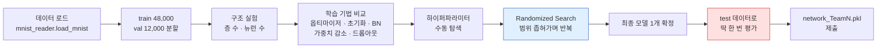
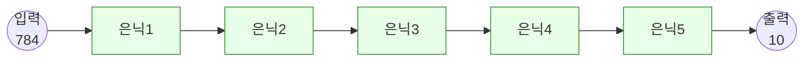
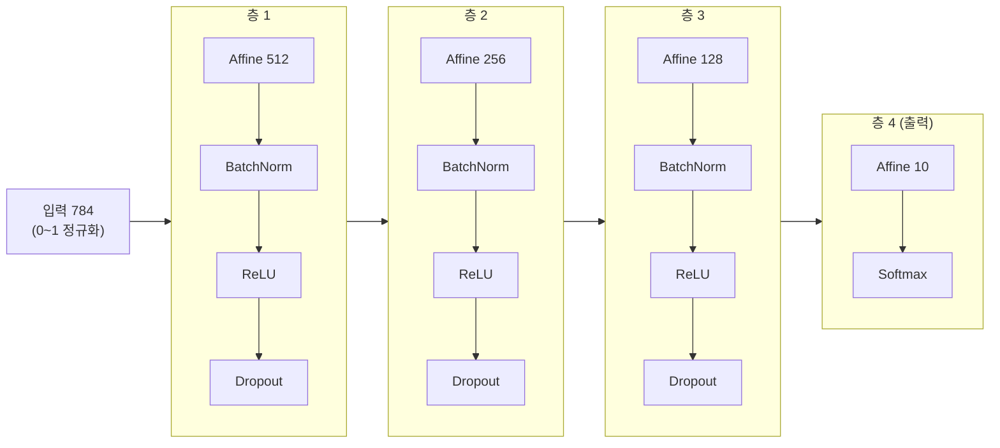
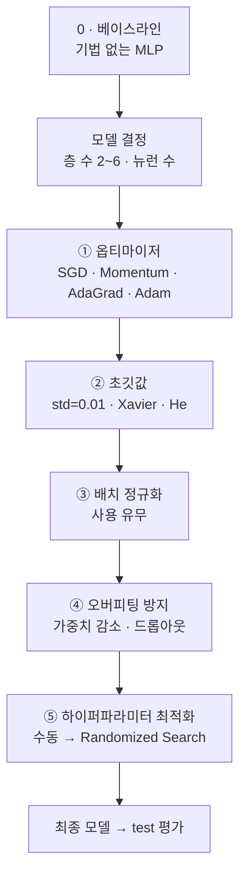
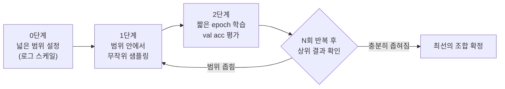
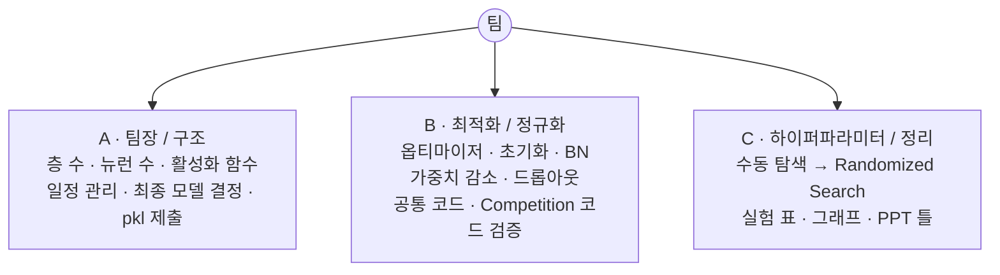
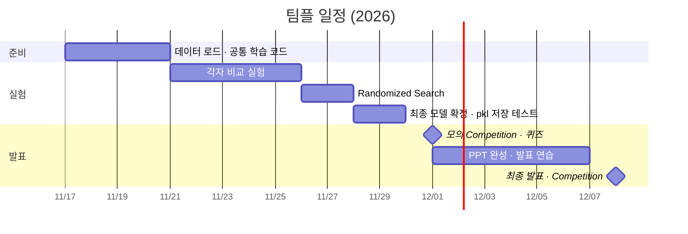
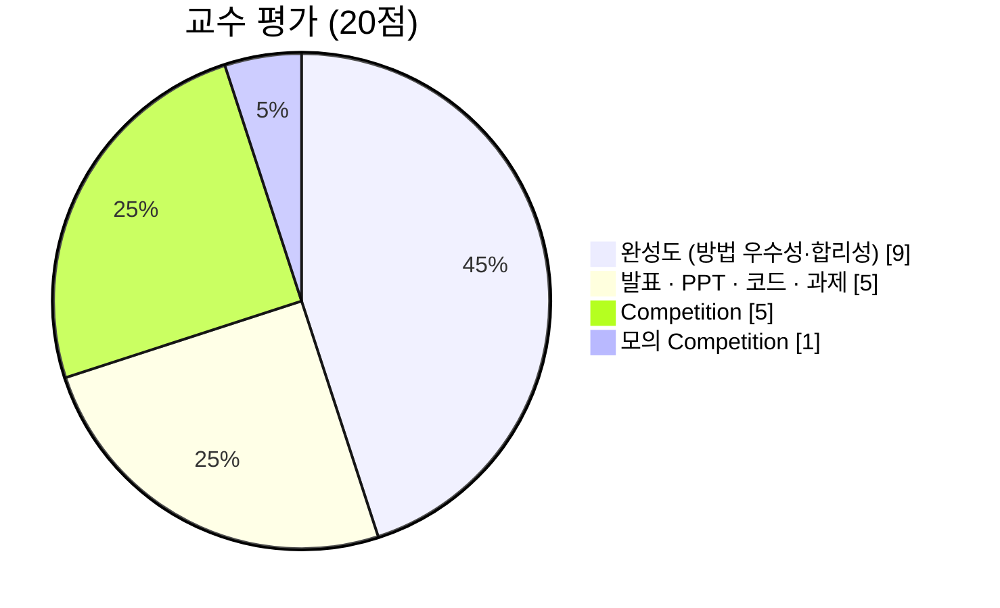

# fashion-mnist-최적화 팀 프로젝트

> 2026 신경망 팀플 — **"우리들의 신경망 모델"**
> Fashion-MNIST를 가장 잘 분류하는 신경망을 **교재 4·5·6장 기법만으로** 찾고, 그 선택이 합리적임을 실험으로 입증한다.

| 항목 | 내용 |
|---|---|
| 데이터 | Fashion-MNIST (28×28 흑백, 10클래스, train 60,000 / test 10,000) |
| 모델 | `MultiLayerNet` / `MultiLayerNetExtend` (완전연결 MLP) |
| 제약 | 교재 **4·5·6장만**, **6층 이하** |
| 필수 | 수동 탐색 → **Randomized Search** |
| 제출 | `network_TeamN.pkl` + 코드(주석 필수) + PPT(팀원 소감 포함) |
| 최종 | **12/8 최종발표 + Competition** (모의 Competition 12/1) |

작업 기록은 [개발일지.md](개발일지.md)에 남긴다.

---

## 1. 한눈에 보는 프로젝트 흐름



> ⚠️ **test 데이터는 마지막 평가(H)에서만 사용한다.** 학습·튜닝은 전부 train/val로만. (안내문: "테스트 데이터를 학습에 사용하는 것은 매우 부적절")

---

## 2. 규칙 체크 — "6층 이하"는 어떻게 세나?

교재는 **가중치(Affine) 층 수 = 은닉층 수 + 1** 로 센다.

| 교재 예시 | `hidden_size_list` | 교재 표현 |
|---|---|---|
| 6.1.8 옵티마이저 비교 | `[100]*4` | 5층 |
| 6.4.1 오버피팅 예시 | `[100]*6` | **7층 ← 조건 위반** |

👉 **`hidden_size_list` 길이는 최대 5.** 교재 예제를 그대로 복붙하면 7층이 되니 주의.



<sub>은닉층 5개 = Affine 6개 = **6층 (허용 최대)**</sub>

---

## 3. 추천 출발 모델 (가설)



```python
from common.multi_layer_net_extend import MultiLayerNetExtend

network = MultiLayerNetExtend(
    input_size=784,
    hidden_size_list=[512, 256, 128],   # 은닉 3개 → 4층 (6층 이하 ✅)
    output_size=10,
    activation='relu',
    weight_init_std='he',               # 6.2 He 초깃값
    weight_decay_lambda=1e-5,           # 6.4.2 가중치 감소 (Randomized Search 대상)
    use_dropout=True,
    dropout_ration=0.2,                 # ⚠️ 인자명 오타 'ration' 그대로 써야 함
    use_batchnorm=True,                 # 6.3 배치 정규화
)
# optimizer='adam' (6.1)
```

- 기대 성능: **test 약 89~90%** (MLP 벤치마크 기준 추정, 아직 우리가 직접 검증한 값 아님)
- 아무 기법 없는 MLP는 약 86~87% → 이 **3~4%p 차이를 기법별 비교 실험으로 설명**하는 것이 발표의 핵심

---

## 4. 쓸 수 있는 기법 vs 쓰면 안 되는 기법

| 기법 | 교재 | 코드 | 사용 |
|---|---|---|:-:|
| 미니배치 학습, 손실함수 | 4장 | `Trainer` | ✅ |
| 오차역전파, ReLU 계층 | 5장 | `layers.py` | ✅ |
| SGD / Momentum / AdaGrad / **Adam** | 6.1 | `optimizer.py` | ✅ |
| **He** / Xavier 초깃값 | 6.2 | `weight_init_std` | ✅ |
| **배치 정규화** | 6.3 | `use_batchnorm` | ✅ |
| **가중치 감소 (L2)** | 6.4.2 | `weight_decay_lambda` | ✅ |
| **드롭아웃** | 6.4.3 | `use_dropout`, `dropout_ration` | ✅ |
| 검증 데이터 분리 | 6.5.1 | `shuffle_dataset` | ✅ |
| **Randomized Search** | 6.5.2~3 | `hyperparameter_optimization.py` | ✅ 필수 |
| AdamW (decoupled weight decay) | 교재 밖 | — | ❌ → `weight_decay_lambda` 사용 |
| Nesterov, RMSprop | 코드엔 있으나 수업 범위 밖 | `optimizer.py` | ❌ |
| Convolution, Pooling (CNN) | 7장 | `layers.py` | ❌ |
| 데이터 증강, LR 스케줄링, 앙상블 | 교재 밖 | — | ❌ |
| 입력 0~1 정규화 | 3장 (전처리) | `normalize=True` | ⚠️ 문제 가능성 낮음, 필요시 교수님 확인 |

---

## 5. 실험 설계 (발표 목차와 동일)

수업 자료의 "팀플: 학습관련 기술들" 체크리스트 순서를 그대로 따른다.



각 단계는 **하나만 바꾸고 나머지는 고정**한 비교 실험(ablation)으로 진행하고, 시드·epoch를 고정해 [개발일지.md](개발일지.md)의 실험 기록 표에 같은 형식으로 남긴다.

### Randomized Search (교재 6.5 방식)



```python
# 예: 탐색 대상과 시작 범위 (로그 스케일 샘플링)
lr            = 10 ** np.random.uniform(-4, -2)
weight_decay  = 10 ** np.random.uniform(-8, -4)
dropout_ratio = np.random.uniform(0.1, 0.5)
hidden        = np.random.choice([128, 256, 512])
```

---

## 6. 역할 분담



---

## 7. 일정



---

## 8. 평가 배점



- 팀원 **전원 발표** (안 하면 감점)
- 동료평가로 개인 점수 **−2 ~ +2** 조정

### Competition 방식
- 교수님이 준비한 **Fashion-MNIST 200개**로 accuracy 순위
- 제출: `network_TeamN.pkl` (`MultiLayerNet` 또는 `MultiLayerNetExtend` 객체)
- 공개된 `Competition_Code_NeuralNet.py`로 채점 → `Neural_net/Competition` 폴더에서 실행되도록 맞출 것

---

## 9. 참고 자료

**데이터셋**
- Xiao, Rasul, Vollgraf (2017). *Fashion-MNIST: a Novel Image Dataset for Benchmarking Machine Learning Algorithms.* [arXiv:1708.07747](https://arxiv.org/abs/1708.07747)
- [zalandoresearch/fashion-mnist](https://github.com/zalandoresearch/fashion-mnist) · 로더: [`utils/mnist_reader.py`](https://github.com/zalandoresearch/fashion-mnist/blob/master/utils/mnist_reader.py)

**Fashion-MNIST MLP 성능 참고**
- MLP 256-128-64, 전처리 없이 test 0.900 — [README 벤치마크 (fork)](https://github.com/nguyenducnhaty/fashion-mnist)
- 비합성곱 다층 신경망 벤치마크, CNN 대비 5~10% 낮음 — [ABCs 2018 논문 사본](https://www.scribd.com/document/656919923/ABCs2018-paper-186)
- 단순 FC 10 epoch 약 86.5% — [rramosp 강의 노트](https://rramosp.github.io/2021.deeplearning/content/U2.02%20-%20The%20Multilayer%20Perceptron.html)

**기법 원 논문 (PPT 근거용, 인용 전 서지 정보 재확인)**
- Adam — Kingma & Ba, 2014
- He 초기화 — He et al., 2015, *Delving Deep into Rectifiers*
- Batch Normalization — Ioffe & Szegedy, 2015
- Dropout — Srivastava et al., 2014, JMLR
- Random Search — Bergstra & Bengio, 2012, JMLR

**교재 코드**
- [WegraLee/deep-learning-from-scratch](https://github.com/WegraLee/deep-learning-from-scratch) — `common/`, `ch06/`

---

## 협업 규칙
- 실험 결과는 [개발일지.md](개발일지.md)의 **실험 기록 표**에 같은 형식으로 추가
- 작업은 브랜치에서 하고 PR로 합치기 (`main` 직접 push 지양)
- 코드에는 **주석 필수**
- 수업 PDF 등 저작권 자료는 저장소에 올리지 않기 (Public 저장소)
