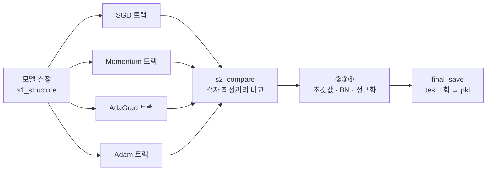

# 실험 폴더 — 13조 실험 설계

> 안내문 목표: **여러 비교 실험을 통해 제안하는 방법의 합리성을 증명**한다.
> 조건: 교재 4·5·6장 기법만 · 6층 이하 · 학습/판단은 train·val 로만 (test 는 최종 평가 1회) · 수동 탐색 후 Randomized Search 필수

## 1. 실험 순서 (수업 슬라이드 "팀플: 학습관련 기술들" 순서)

| 단계 | 파일 | 담당 | 무엇을 보이나 |
|---|---|---|---|
| 모델 결정 | `s1_structure.py` (`depth` → `width`) | 팀장 | 층 수(2~6층)·뉴런 수 → 4개 옵티마이저 **평균** val 이 가장 높은 구조 |
| ① 옵티마이저 | `s2_sgd.py` · `s2_momentum.py` · `s2_adagrad.py` · `s2_adam.py` | 팀장 2개 · 팀원 2명 1개씩 | 각 옵티마이저의 **최선** (수동 탐색 → 무작위 탐색 → seed 3개 확인) |
| ① 비교 | `s2_compare.py` | 팀장 | **각자 최선끼리** 같은 조건으로 비교 → 제안 옵티마이저 |
| ②③④ | 트랙이 끝난 뒤 분담 | 미정 | 초깃값(std 0.01 / Xavier / He) · 배치 정규화 · 가중치 감소·드롭아웃 |
| 최종 | `final_save.py` | 팀장 | 최선의 모델 1개 → test 1회 → `../Competition/network_Team13.pkl` |



## 2. 공정한 비교 규칙 — `team_common.py` (팀장만 수정)

| 규칙 | 값 | 이유 |
|---|---|---|
| 같은 데이터 분할 | `SPLIT_SEED = 0`, train 48,000 / val 12,000 | 누가 돌려도 같은 문제를 푼다 |
| 같은 구조·초깃값·배치 | `HIDDEN`, He, ReLU, 배치 128 | 옵티마이저 말고는 같게 (한 번에 하나만 바꿈) |
| 같은 탐색 예산 | 수동 10 epoch · 무작위 30회 × 5 epoch (최대 2라운드) · 확인 seed 3개 × 20 epoch | "더 오래 찾은 사람이 이김"을 막음 |
| 같은 판단 기준 | 학습 직후 **val 12,000장 전체** 정확도 | Competition 점수(accuracy)와 같은 단위, test 는 안 씀 |
| seed 3개 평균 ± 표준편차 | `SEEDS = [0, 1, 2]` | 한 번의 우연으로 결론 내지 않음 |

**판정 (`s2_compare.py`)**: ★ 최고 / **비슷함** (차이 < max(0.5%p, 두 표준편차의 합)) / 낮음.
'비슷함'이면 더 빠르거나 gap(train − val)이 작은 쪽을 근거와 함께 고를 수 있다.

## 3. 트랙 담당자 할 일

팀은 **팀장 포함 3명**: 팀장이 트랙 2개, 나머지 팀원 2명이 1개씩 맡는다.

| 트랙 | 파일 | 담당 (팀장 ×2, 팀원 ×1, 팀원 ×1) |
|---|---|---|
| SGD | `s2_sgd.py` | |
| Momentum | `s2_momentum.py` | |
| AdaGrad | `s2_adagrad.py` | |
| Adam | `s2_adam.py` | |

```bash
# 0) 브랜치 만들기 (test 에서 시작)
git switch test
git pull
git switch -c exp/이름-옵티마이저        # 예: exp/minji-adam
cd v3/experiments
```

1. **(처음 한 번) 코드 확인**: 파일 맨 위 `QUICK = True` → `python s2_adam.py` (몇 초) → 에러 없으면 `QUICK = False` 로 되돌림
2. **수동 탐색**: `STEP = 'manual'` → 실행 → 출력의 "가장 좋은 학습률" 주변으로 `LR_RANGE` 를 정함
3. **무작위 탐색**: `STEP = 'random'`, `ROUND = 1` → 실행 → 출력된 **"상위 5개 범위"** 로 `LR_RANGE`·`WD_RANGE` 를 좁히고 `ROUND = 2` 로 한 번 더
4. **확인**: 출력된 최고값을 `BEST_LR`, `BEST_WD` 에 적고 `STEP = 'confirm'` → `val acc 0.xxxx ± 0.xxxx`
5. **PR**: 자기 트랙 파일 + `../results/<옵티마이저>_*` 만 커밋 → push → PR (**base: `test`**) → 본문에 4)의 결과 줄과 "범위를 왜 그렇게 좁혔는지" 적기

- AI·논문으로 범위의 시작값을 정해도 된다. 대신 **출처(논문 이름·수치)를 PR 에 적고**, 최종 근거는 우리 val 실험 결과(csv·그래프)로 한다.
- 고유 값(`OPTIMIZER_PARAM`: Momentum 의 `momentum`, Adam 의 `beta1`·`beta2`)은 교재 기본값으로 시작. 바꿨다면 PR 에 근거를 적는다.

**하면 안 되는 것**: `team_common.py`·`common/` 수정 · test(t10k) 사용 · 다른 트랙 파일 수정 · 남의 결과 파일 덮어쓰기

## 4. 결과 파일 (`v3/results/`)

| 파일 | 만드는 곳 | 내용 |
|---|---|---|
| `structure_depth.*`, `structure_width.*` | s1 | 구조 × 옵티마이저 val 정확도 표·그래프 |
| `<옵티마이저>_manual.csv/png` | s2 manual | 학습률별 학습 곡선 (실선 val, 점선 train) |
| `<옵티마이저>_random_r<N>.csv`, `_top20.png`, `_scatter.png` | s2 random | 교재 형식 상위 20개 곡선 + 학습률·가중치 감소별 산점도 |
| `<옵티마이저>_confirm.csv/png` | s2 confirm | seed 3개 결과 |
| `optimizer_compare.csv/png` | s2_compare | 순위·판정 표, 막대(평균 ± 표준편차)·학습 곡선 |
| `final.csv/png` | final_save | 최종 설정·val·test 정확도·pkl 크기 |

csv 열: `optimizer, step, round, lr, weight_decay, optimizer_param, hidden, seed, epochs, train_acc, val_acc, gap, sec, val_curve, train_curve`
(`quick_*` 파일은 코드 확인용이라 git 에 올라가지 않는다)

## 5. 교재 코드와의 대응

| 우리 파일 | 따라 한 교재 코드 (ch06) |
|---|---|
| `team_common.load_train_val` | `hyperparameter_optimization.py` 의 검증 데이터 분할 (`shuffle_dataset` + 20%) |
| `s2_*.py` 의 `__train`, 무작위 탐색 루프 | `hyperparameter_optimization.py` (`10 ** np.random.uniform(a, b)`) |
| `s1_structure.py` | `optimizer_compare_mnist.py` (4개 옵티마이저) + `Trainer` |
| 그래프 (실선 val · 점선 train, 상위 20개 격자) | `overfit_*.py`, `hyperparameter_optimization.py` |
| `final_save.py` 의 pkl 저장 | 교수님 `Competition_Code_NeuralNet.py` 의 저장 예시 |
