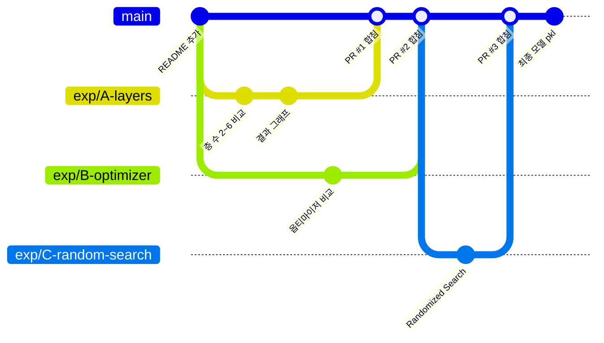
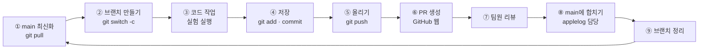
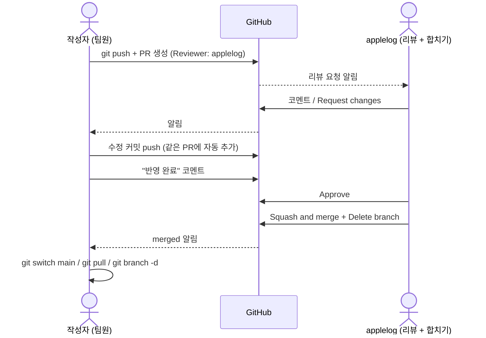

# 협업 가이드 — Git & GitHub로 같이 작업하기

> 이 문서 하나만 따라 하면 **처음 Git을 쓰는 사람도** 우리 저장소에서 브랜치 만들고, 커밋하고, PR 올리고, 합칠 수 있게 쓰는 것이 목표입니다.
> 모르는 게 생기면 [9. 자주 하는 실수와 해결법](#9-자주-하는-실수와-해결법)과 [11. FAQ](#11-faq)부터 보세요.

- 저장소: https://github.com/applelog/fashion-mnist-optimization-team-project
- 기본 브랜치: `main`
- 프로젝트 개요: [README.md](README.md) · 실험 기록: [개발일지.md](개발일지.md)

---

## 목차

0. [큰 그림: 우리가 일하는 방식](#0-큰-그림-우리가-일하는-방식)
1. [용어 정리 (이것만 알면 됨)](#1-용어-정리-이것만-알면-됨)
2. [처음 한 번만 하는 준비](#2-처음-한-번만-하는-준비)
3. [저장소 폴더 구조와 규칙](#3-저장소-폴더-구조와-규칙)
4. [매일 하는 작업 흐름 (핵심)](#4-매일-하는-작업-흐름-핵심)
5. [브랜치 이름 규칙](#5-브랜치-이름-규칙)
6. [커밋 메시지 규칙](#6-커밋-메시지-규칙)
7. [Pull Request(PR) 올리기 · 리뷰 · 합치기](#7-pull-requestpr-올리기--리뷰--합치기)
8. [충돌(Conflict) 해결하기](#8-충돌conflict-해결하기)
9. [자주 하는 실수와 해결법](#9-자주-하는-실수와-해결법)
10. [VS Code로 버튼만 눌러서 하기](#10-vs-code로-버튼만-눌러서-하기)
11. [FAQ](#11-faq)
12. [명령어 치트시트](#12-명령어-치트시트)

---

## 0. 큰 그림: 우리가 일하는 방식

**한 줄 요약:** `main`은 항상 "돌아가는 최신본"으로 두고, 각자 **자기 브랜치**에서 작업한 뒤 **PR(Pull Request)** 을 올린다. **`main`에 합치기(Merge)는 저장소 관리자 `applelog` 만 한다.**

> 🔒 **합치기 담당: `applelog`**
> - 팀원은 PR을 올리고 **Reviewers에 `applelog` 를 지정**하는 데까지만 합니다.
> - PR 화면의 초록색 **Merge 버튼은 누르지 마세요.** (권한상 눌리긴 하지만, 누르지 않는 것이 우리 규칙입니다)
> - 합쳐지면 GitHub 알림이 오고, 그때 [내 컴퓨터 정리](#합친-뒤-정리하기)만 하면 됩니다.





### 왜 이렇게 하나?
| 방법 | 문제 |
|---|---|
| 카톡으로 `.py` 파일 주고받기 | 누가 언제 뭘 바꿨는지 모름, `최종_진짜최종_v3.py` 지옥 |
| 다 같이 `main`에 바로 push | 한 사람이 망가뜨리면 모두의 코드가 깨짐, 충돌 폭발 |
| **브랜치 + PR** | 각자 안전하게 실험, 합치기 전에 서로 확인, 기록이 전부 남음 → **PPT에 "실험 과정" 근거로도 사용 가능** |

---

## 1. 용어 정리 (이것만 알면 됨)

| 용어 | 비유 | 설명 |
|---|---|---|
| **저장소 (repository, repo)** | 공유 폴더 | 프로젝트 파일 + 모든 변경 기록 |
| **원격 저장소 (origin)** | 구글 드라이브 | GitHub에 있는 저장소 |
| **로컬 저장소** | 내 컴퓨터 폴더 | `clone`으로 내려받은 복사본 |
| **커밋 (commit)** | 게임 세이브 포인트 | "이 시점의 파일 상태"를 메시지와 함께 저장 |
| **브랜치 (branch)** | 평행 세계 | `main`을 건드리지 않고 따로 작업하는 공간 |
| **`main`** | 정본 | 항상 돌아가는 최신 버전 |
| **스테이징 (add)** | 택배 상자에 담기 | 다음 커밋에 넣을 파일 고르기 |
| **push** | 업로드 | 내 커밋 → GitHub |
| **pull** | 다운로드 + 합치기 | GitHub의 새 커밋 → 내 컴퓨터 |
| **PR (Pull Request)** | 결재 요청 | "내 브랜치를 main에 합쳐도 될까요?" 요청 + 리뷰 공간 |
| **merge** | 합치기 | 브랜치 내용을 main에 반영 |
| **충돌 (conflict)** | 같은 줄을 둘이 고침 | Git이 어느 쪽을 살릴지 몰라 사람에게 물어보는 상황 |

---

## 2. 처음 한 번만 하는 준비

### 2-1. 초대 수락 ✉️
1. GitHub에 가입한 이메일로 온 **초대 메일**을 열거나,
   https://github.com/applelog/fashion-mnist-optimization-team-project/invitations 에 접속
2. **Accept invitation** 클릭
3. 수락해야 push 권한이 생깁니다. (초대는 7일 지나면 만료 → 팀장에게 다시 요청)

### 2-2. Git 설치 확인
터미널(맥: Terminal / 윈도우: **Git Bash** 또는 PowerShell)에서:

```bash
git --version
```

- `git version 2.x.x` 가 나오면 OK
- 안 나오면 설치:
  - **macOS:** `xcode-select --install` 또는 https://git-scm.com/download/mac
  - **Windows:** https://git-scm.com/download/win (설치 옵션은 전부 기본값으로 Next)

### 2-3. 내 이름·이메일 등록 (커밋에 찍히는 정보)

```bash
git config --global user.name "내 이름 또는 GitHub 아이디"
```

```bash
git config --global user.email "GitHub에 등록한 이메일"
```

> 💡 이메일을 GitHub 계정 이메일과 똑같이 써야 GitHub에서 내 커밋에 프로필 사진이 붙고, 기여도(잔디)에 잡힙니다.
> 이메일을 공개하기 싫으면 GitHub → Settings → Emails 의 `xxxx@users.noreply.github.com` 주소를 쓰세요.

기본 브랜치 이름과 pull 방식도 한 번 설정해 두세요:

```bash
git config --global init.defaultBranch main
```

```bash
git config --global pull.rebase false
```

**Windows만:** (맥·리눅스와 줄바꿈 문자가 달라서 생기는 가짜 변경 방지)

```bash
git config --global core.autocrlf true
```

### 2-4. GitHub 로그인 (push 권한 인증)

GitHub는 **비밀번호로 push 불가**입니다. 아래 둘 중 하나를 고르세요.

**방법 A — GitHub CLI (추천, 가장 쉬움)**
1. 설치: https://cli.github.com (맥은 `brew install gh`)
2. 로그인:

```bash
gh auth login
```

3. 질문에는 `GitHub.com` → `HTTPS` → `Yes (Git 인증에 사용)` → `Login with a web browser` 선택 → 화면에 나온 코드를 브라우저에 입력

**방법 B — VS Code / GitHub Desktop**
- 처음 push할 때 브라우저 로그인 창이 뜨면 로그인하면 끝

### 2-5. 저장소 내려받기 (clone)

작업할 폴더로 이동한 뒤:

```bash
git clone https://github.com/applelog/fashion-mnist-optimization-team-project.git
```

```bash
cd fashion-mnist-optimization-team-project
```

확인:

```bash
git status
```

`On branch main ... nothing to commit, working tree clean` 이 나오면 준비 완료 🎉

### 2-6. 파이썬 환경
- 교재 코드(`common/`)와 `numpy`, `matplotlib`, `pickle`(내장)만 사용
- **팀 전원 같은 버전**을 쓰면 `pkl` 호환 문제가 줄어듭니다. 버전 확인:

```bash
python --version
```

```bash
python -c "import numpy; print(numpy.__version__)"
```

> 결과를 개발일지에 적어 두고 맞추세요. (Competition 때 교수님 컴퓨터에서 `pkl`이 열려야 하므로 특히 중요)

---

## 3. 저장소 폴더 구조와 규칙

### 3-1. 권장 구조

```text
fashion-mnist-optimization-team-project/
├── README.md              # 프로젝트 개요 (수정은 팀장과 상의)
├── 협업가이드.md           # 이 문서
├── 개발일지.md             # 일지 + 실험 기록 표 (모두 추가)
├── common/                # 교재 공통 코드 (B 담당, 함부로 수정 X)
├── data/                  # Fashion-MNIST .gz 원본 → git에 안 올라감 (.gitignore)
├── experiments/
│   ├── A_layers/          # A: 층 수·뉴런 수 실험
│   ├── B_optimizer/       # B: 옵티마이저·초기화·BN·정규화 실험
│   └── C_random_search/   # C: 하이퍼파라미터 탐색
├── results/               # 그래프 png, 실험 결과 csv
└── final/                 # 최종 모델 학습 코드 + network_TeamN.pkl
```

### 3-2. 지켜야 할 규칙
| 규칙 | 이유 |
|---|---|
| **자기 폴더(`experiments/담당_주제/`)에서만 작업** | 남의 파일을 동시에 고치면 충돌 |
| `common/` 수정은 **B와 상의 후 별도 PR** | 모두가 쓰는 코드라 한 번 바뀌면 전원 결과가 달라짐 |
| 데이터셋(`.gz`)은 올리지 않기 | 용량 큼 + 이미 `.gitignore` 처리됨. 각자 `data/`에 다운로드 |
| 수업 PDF·hwp 올리지 않기 | **Public 저장소**라 저작권 문제 (`.gitignore` 처리됨) |
| 비밀번호·토큰·개인정보 올리지 않기 | Public이라 전 세계가 봄 |
| 100MB 넘는 파일 금지 | GitHub가 거부함. 50MB 넘으면 경고 |
| **test 데이터로 학습·튜닝한 코드 금지** | 안내문 핵심 규칙. 리뷰 때 반드시 확인 |
| 코드 **주석 필수** | 평가 항목 |

### 3-3. 데이터 받는 법 (각자 1번)
https://github.com/zalandoresearch/fashion-mnist#get-the-data 에서 4개 파일을 받아 `data/` 폴더에 넣기:

```text
data/train-images-idx3-ubyte.gz
data/train-labels-idx1-ubyte.gz
data/t10k-images-idx3-ubyte.gz
data/t10k-labels-idx1-ubyte.gz
```

---

## 4. 매일 하는 작업 흐름 (핵심)

> 🔁 **작업 시작할 때마다 ①부터.** 이 섹션만 외워도 협업의 90%는 끝납니다.

### ① main을 최신으로

```bash
git switch main
```

```bash
git pull
```

> 다른 팀원이 합친 내용을 먼저 받아야 나중에 충돌이 적습니다.

### ② 내 작업용 브랜치 만들기

```bash
git switch -c exp/A-layers
```

- `-c` = create(새로 만들기). 이미 있는 브랜치로 갈 때는 `-c` 없이 `git switch exp/A-layers`
- 이름 규칙은 [5. 브랜치 이름 규칙](#5-브랜치-이름-규칙) 참고
- 지금 어느 브랜치인지 확인 (`*` 표시된 게 현재 브랜치):

```bash
git branch
```

### ③ 작업하기
코드 짜고, 실험 돌리고, 결과 그래프 저장하고, [개발일지.md](개발일지.md) 실험 기록 표에 한 줄 추가.

### ④ 커밋하기 (세이브)

1) 뭐가 바뀌었는지 보기

```bash
git status
```

```bash
git diff
```

2) 커밋에 넣을 파일 고르기 (스테이징)

```bash
git add experiments/A_layers/layer_compare.py results/A_layer_compare.png
```

- 폴더 통째로: `git add experiments/A_layers/`
- 바뀐 것 전부: `git add .` ← **편하지만 이상한 파일까지 들어갈 수 있으니 `git status`로 꼭 먼저 확인**

3) 커밋

```bash
git commit -m "[A] 층 수 2~6 비교 실험 추가"
```

> 💡 **커밋은 자주, 작게.** "실험 하나 끝남", "버그 하나 고침" 단위로 커밋하세요. 하루 작업을 커밋 1개로 몰아넣으면 나중에 되돌리기 어렵습니다.

### ⑤ GitHub에 올리기 (push)

**처음 push할 때만** (브랜치를 GitHub에 등록):

```bash
git push -u origin exp/A-layers
```

그다음부터는 그냥:

```bash
git push
```

### ⑥ PR 만들기
push하면 터미널에 링크가 뜨거나, GitHub 저장소 페이지 위에 노란 배너 **"Compare & pull request"** 가 뜹니다. 클릭 → [7장](#7-pull-requestpr-올리기--리뷰--합치기)대로 작성.

CLI로 바로 만들 수도 있습니다:

```bash
gh pr create --base main --fill
```

### ⑦~⑨ 리뷰 · 합치기 · 정리
<a id="합친-뒤-정리하기"></a>
리뷰는 [7장](#7-pull-requestpr-올리기--리뷰--합치기) 참고. **합치기는 `applelog` 가 합니다.** "merged" 알림이 오면 내 컴퓨터를 정리합니다:

```bash
git switch main
```

```bash
git pull
```

```bash
git branch -d exp/A-layers
```

→ 다음 작업은 다시 ①부터, **새 브랜치**로.

### 작업 도중 main이 바뀌었다면? (팀원 PR이 먼저 합쳐짐)
내 브랜치에 최신 main을 가져와 합칩니다:

```bash
git switch main
```

```bash
git pull
```

```bash
git switch exp/A-layers
```

```bash
git merge main
```

충돌이 나면 [8장](#8-충돌conflict-해결하기)으로.

---

## 5. 브랜치 이름 규칙

형식: **`종류/담당-주제`** (영어 소문자, 단어는 `-`로 연결, 한글·공백 X)

| 종류 | 언제 | 예시 |
|---|---|---|
| `exp/` | 실험 | `exp/A-layers`, `exp/B-batchnorm`, `exp/C-random-search` |
| `feat/` | 공통 기능 추가 | `feat/B-data-loader`, `feat/B-save-pkl` |
| `fix/` | 버그 수정 | `fix/B-val-split-seed` |
| `docs/` | 문서·일지·README | `docs/C-ppt-outline`, `docs/A-1124-log` |
| `final/` | 최종 모델 | `final/A-model-v1` |

- **브랜치 하나 = 주제 하나.** 옵티마이저 실험과 드롭아웃 실험은 브랜치를 나누면 리뷰·되돌리기가 쉽습니다.
- 다 쓴 브랜치는 합친 뒤 지웁니다 (GitHub PR 화면의 **Delete branch** 버튼).

---

## 6. 커밋 메시지 규칙

### 형식

```text
[담당] 무엇을 했는지 한 줄 (50자 이내)

(선택) 왜 했는지 / 결과 수치 / 참고 사항
```

### 좋은 예 ✅
```text
[A] 층 수 2~6 비교 실험 추가

hidden 100 고정, Adam lr=0.001, 20 epoch, seed 42
val acc: 2층 87.1 / 3층 88.2 / 4층 88.9 / 5층 88.7 / 6층 88.4
→ 4층 채택, 개발일지 실험 기록 표 갱신
```
<sub>(위 수치는 형식 예시입니다. 실제 결과로 쓰세요.)</sub>

```text
[B] He vs Xavier vs std=0.01 초깃값 비교 그래프 추가
```
```text
[B] fix: 검증 데이터 분할 시 seed 고정 안 되던 문제 수정
```
```text
[C] Randomized Search 1차 (100회, lr 1e-4~1e-2)
```

### 나쁜 예 ❌
| 메시지 | 문제 |
|---|---|
| `수정` | 뭘 수정? |
| `ㅇㅇ`, `asdf` | 기록 가치 0 |
| `최종` | 최종이 몇 번 나올지 모름 |
| `여러가지 수정` | 커밋을 나눠야 한다는 신호 |

> 💡 실험 결과 수치를 커밋 본문에 적어 두면, PPT 만들 때 `git log`로 바로 찾을 수 있습니다.

긴 메시지는 `-m` 없이 `git commit` 만 치면 편집기가 열립니다. 기본 편집기가 vim이면 `i` 눌러 입력 → `Esc` → `:wq` 엔터로 저장합니다. 어렵다면 VS Code를 편집기로 지정하세요:

```bash
git config --global core.editor "code --wait"
```

---

## 7. Pull Request(PR) 올리기 · 리뷰 · 합치기

### 7-1. PR 작성
GitHub에서 **Compare & pull request** → 아래처럼 작성 (저장소에 [PR 템플릿](.github/pull_request_template.md)이 있어서 본문이 자동으로 채워집니다)

- **base:** `main` ← **compare:** `내 브랜치` 인지 확인
- **제목:** 커밋 메시지처럼 `[A] 층 수 2~6 비교 실험`
- **본문:** 무엇을 / 왜 / 결과 / 체크리스트
- 오른쪽 **Reviewers** 에서 **`applelog` 는 꼭** 지정 (+ 다른 팀원도 지정하면 좋음)
- 아직 작업 중이면 **Create draft pull request** (초안) 로 올려 두고, 끝나면 **Ready for review**

### 7-2. 리뷰하는 법 (리뷰어)
1. PR → **Files changed** 탭
2. 이상한 줄 옆 `+` 를 눌러 코멘트
3. 꼭 볼 것:
   - [ ] **test 데이터를 학습·튜닝에 쓰지 않았는가?** (`x_test`가 `Trainer`나 탐색 코드에 들어가 있으면 ❌)
   - [ ] 6층 이하인가? (`hidden_size_list` 길이 ≤ 5)
   - [ ] 교재 4·5·6장 기법만 썼는가?
   - [ ] 주석이 있는가?
   - [ ] seed·epoch가 개발일지에 기록됐는가?
4. 오른쪽 위 **Review changes** →
   - **Approve** (좋음) / **Comment** (의견만) / **Request changes** (수정 필요)

> 리뷰 말투는 안내문 규칙대로 **"예쁘게 말하기"** 😊 — "이건 틀렸어요" 대신 "여기 x_test 대신 x_val 쓰면 어떨까요?"

### 7-3. 리뷰 반영 (작성자)
같은 브랜치에서 고치고 커밋·push 하면 **PR에 자동으로 추가**됩니다. 새 PR 만들 필요 없음.

```bash
git add .
```

```bash
git commit -m "[A] 리뷰 반영: 검증 데이터로 교체"
```

```bash
git push
```

### 7-4. 합치기 (Merge) — `applelog` 만

**팀원(PR 작성자)이 할 일**
- Merge 버튼 누르지 않기
- 리뷰 반영이 끝나면 PR에 "반영 완료했습니다" 코멘트 남기기
- 급하면 단톡방에 PR 링크 공유
- "merged" 알림이 오면 [내 컴퓨터 정리](#합친-뒤-정리하기)

**`applelog` 가 할 일 (합치기 전 체크)**
- [ ] 7-2 리뷰 체크리스트 통과 (test 데이터 미사용, 6층 이하, 4~6장, 주석, 개발일지 기록)
- [ ] 충돌 없음 (PR 아래에 "This branch has no conflicts with the base branch" 표시)
- [ ] 버튼 옆 ▼ 에서 **Squash and merge** 선택 → 브랜치의 자잘한 커밋들이 main에 커밋 1개로 깔끔하게 들어감
- [ ] 합친 뒤 **Delete branch** 클릭

> 충돌이 있다고 나오면 `applelog` 가 직접 고치지 않고, 작성자에게 "main 병합 후 충돌 해결 부탁해요"라고 요청합니다 → 작성자는 [4장 "작업 도중 main이 바뀌었다면?"](#작업-도중-main이-바뀌었다면-팀원-pr이-먼저-합쳐짐) + [8장](#8-충돌conflict-해결하기)대로 해결 후 push.



---

## 8. 충돌(Conflict) 해결하기

### 8-1. 충돌은 왜 생기나?
**두 사람이 같은 파일의 같은 줄 근처를 다르게 고쳤을 때.** 우리 팀에서 가장 흔한 곳은 **[개발일지.md](개발일지.md) 실험 기록 표** (다 같이 맨 아래에 한 줄씩 추가하니까).

### 8-2. 충돌 화면 읽는 법
`git merge main` 또는 `git pull` 후 이런 메시지가 나오면:

```text
CONFLICT (content): Merge conflict in 개발일지.md
Automatic merge failed; fix conflicts and then commit the result.
```

파일을 열면 이렇게 표시돼 있습니다:

```text
| 11/24 | A | 층 수 비교 | ... |
<<<<<<< HEAD
| 11/25 | A | 뉴런 수 비교 | 512-256-128 / Adam | 20 | 0.93 | 0.89 | |
=======
| 11/25 | B | 옵티마이저 비교 | 100x4 / Adam | 20 | 0.92 | 0.88 | |
>>>>>>> main
```

| 표시 | 의미 |
|---|---|
| `<<<<<<< HEAD` ~ `=======` | **내 브랜치** 내용 |
| `=======` ~ `>>>>>>> main` | **들어오는 쪽(main)** 내용 |

### 8-3. 해결 순서
1. 둘 중 무엇을 남길지 정해서 **직접 편집** — 실험 기록 표는 보통 **둘 다 남기면** 됩니다:

```text
| 11/24 | A | 층 수 비교 | ... |
| 11/25 | A | 뉴런 수 비교 | 512-256-128 / Adam | 20 | 0.93 | 0.89 | |
| 11/25 | B | 옵티마이저 비교 | 100x4 / Adam | 20 | 0.92 | 0.88 | |
```

2. `<<<<<<<`, `=======`, `>>>>>>>` 줄은 **전부 지우기** (남아 있으면 파일이 깨짐)
3. 저장 후:

```bash
git add 개발일지.md
```

```bash
git commit -m "main 병합 충돌 해결 (실험 기록 표)"
```

```bash
git push
```

> 💡 VS Code는 충돌 부분 위에 **Accept Current / Accept Incoming / Accept Both** 버튼을 띄워 줍니다. 표는 보통 **Accept Both**.

### 8-4. 무서우면 일단 취소
충돌 해결 도중 꼬였다면 병합 시작 전으로 돌아갈 수 있습니다:

```bash
git merge --abort
```

### 8-5. 충돌을 줄이는 습관
- 작업 시작 전 항상 `git switch main` → `git pull`
- 브랜치를 오래 끌지 말고 **1~2일 안에 PR**
- 자기 폴더에서만 작업
- 개발일지는 **자기 줄만 추가**하고, 남의 줄은 고치지 않기
- 같은 파일을 고쳐야 하면 단톡방에 미리 말하기

---

## 9. 자주 하는 실수와 해결법

| 상황 | 해결 |
|---|---|
| **커밋 메시지 오타** (아직 push 전) | `git commit --amend -m "새 메시지"` |
| **파일 하나 빠뜨리고 커밋** (push 전) | `git add 빠진파일` → `git commit --amend --no-edit` |
| **방금 커밋 취소, 변경 내용은 유지** (push 전) | `git reset --soft HEAD~1` |
| **add 취소** (커밋 전) | `git restore --staged 파일명` |
| **파일 수정 내용 버리고 마지막 커밋 상태로** | `git restore 파일명` ⚠️ 되돌릴 수 없음 |
| **실수로 main에서 작업함** (커밋 전) | `git switch -c exp/새브랜치` → 바뀐 내용이 그대로 새 브랜치로 옮겨짐 |
| **실수로 main에 커밋함** (push 전) | `git branch exp/새브랜치` → `git reset --hard origin/main` → `git switch exp/새브랜치` |
| **이미 push한 커밋을 되돌리고 싶음** | `git revert 커밋ID` (되돌리는 새 커밋을 만듦, 안전) |
| `git push` 가 **rejected** 됨 | 원격에 내가 없는 커밋이 있다는 뜻 → `git pull` 후 다시 `git push` |
| `pull` 하려는데 "local changes would be overwritten" | 지금 작업을 먼저 커밋하거나, 잠시 치워두기: `git stash` → `git pull` → `git stash pop` |
| 브랜치 바꾸려는데 같은 오류 | 위와 같이 커밋 또는 `git stash` |
| **비밀번호/토큰을 커밋해 push함** | 즉시 팀장에게 알리고 **해당 비밀번호·토큰을 폐기(재발급)**. 기록에서 지우는 것만으로는 부족 |
| 큰 파일(100MB+) 때문에 push 실패 | `git reset --soft HEAD~1` → 큰 파일 `git restore --staged` → `.gitignore`에 추가 → 다시 커밋 |

### 🚫 절대 하지 말 것
- `main`에 직접 push (꼭 PR로)
- PR의 **Merge 버튼 누르기** (합치기는 `applelog` 담당 — 내 PR이어도 X)
- `git push --force` (남의 커밋을 지울 수 있음. 꼭 필요하면 팀장과 상의)
- 남의 브랜치에서 작업
- `.gz` 데이터, 수업 PDF, 비밀번호 올리기

> 커밋 ID는 `git log --oneline` 으로 확인 (맨 앞 7자리, 예: `3a46fdf`)

---

## 10. VS Code로 버튼만 눌러서 하기

터미널이 낯설면 VS Code의 **소스 제어(Source Control)** 패널로 똑같이 할 수 있습니다.

| 하고 싶은 것 | VS Code에서 |
|---|---|
| clone | `Ctrl/Cmd + Shift + P` → `Git: Clone` → 저장소 주소 붙여넣기 |
| 브랜치 만들기/바꾸기 | **왼쪽 아래 브랜치 이름** 클릭 → `Create new branch...` |
| 바뀐 파일 보기 | 왼쪽 세 번째 아이콘(갈래 모양) = 소스 제어 패널 |
| add | 파일 옆 **`+`** |
| commit | 위 입력칸에 메시지 → **✓ Commit** |
| push / pull | 왼쪽 아래 **동기화(↻) 버튼** 또는 `...` 메뉴 → Push / Pull |
| 충돌 해결 | 충돌 파일 열면 **Accept Current / Incoming / Both** 버튼 |
| 변경 기록 보기 | 확장 **GitLens** 또는 **Git Graph** 설치 추천 |
| PR 만들기 | 확장 **GitHub Pull Requests** 설치 → 패널에서 바로 생성·리뷰 |

> GitHub Desktop(https://desktop.github.com)도 같은 일을 버튼으로 할 수 있습니다. 편한 걸 쓰세요.

---

## 11. FAQ

**Q. `pkl` 파일(학습된 모델)도 올려도 되나요?**
A. 최종 모델 `final/network_TeamN.pkl` 은 올립니다(보통 수 MB). 실험 중 생긴 pkl은 너무 많아지니 올리지 말고 결과 수치·그래프만 올리세요. 필요하면 `.gitignore`에 `experiments/**/*.pkl` 추가.

**Q. 실험이 오래 걸려서 결과가 아직 안 나왔는데 코드만 먼저 올려도 되나요?**
A. 네. **Draft PR**로 올려 두면 팀원이 미리 코드를 볼 수 있습니다.

**Q. 남의 PR 코드를 내 컴퓨터에서 돌려 보고 싶어요.**

```bash
gh pr checkout PR번호
```

또는 `git fetch` → `git switch 브랜치이름`

**Q. `git pull` 했더니 편집기(vim)가 열리고 "Merge branch..." 라고 나와요.**
A. 병합 커밋 메시지를 확인하는 화면입니다. 그대로 `Esc` → `:wq` → 엔터.

**Q. 내가 뭘 했는지 헷갈려요.**

```bash
git status
```

```bash
git log --oneline --graph --all
```

**Q. Competition 직전에 최종 모델을 누가 올리나요?**
A. 팀장(A)이 `final/A-model-v1` 같은 브랜치로 PR → 전원 리뷰 → `applelog` 가 합친 뒤 **교수님 `Competition_Code_NeuralNet.py`로 실행 테스트(B)** → 제출.

**Q. 내 PR이 승인됐는데 왜 안 합쳐지나요?**
A. 합치기는 `applelog` 만 합니다. 기다리거나 단톡방에 PR 링크를 공유하세요. 직접 Merge 버튼은 누르지 마세요.

---

## 12. 명령어 치트시트

| 목적 | 명령 |
|---|---|
| 상태 확인 | `git status` |
| 바뀐 내용 보기 | `git diff` |
| 기록 보기 | `git log --oneline --graph` |
| 최신 받기 | `git switch main` → `git pull` |
| 새 브랜치 | `git switch -c exp/A-주제` |
| 브랜치 이동 | `git switch 브랜치이름` |
| 브랜치 목록 | `git branch` (원격 포함: `git branch -a`) |
| 스테이징 | `git add 파일` / `git add .` |
| 커밋 | `git commit -m "[A] 메시지"` |
| 첫 push | `git push -u origin 브랜치이름` |
| push | `git push` |
| main 내용 내 브랜치로 | `git merge main` |
| PR 만들기 | `gh pr create --base main --fill` |
| PR 목록 | `gh pr list` |
| 작업 임시 보관 | `git stash` / 꺼내기 `git stash pop` |
| 브랜치 삭제 | `git branch -d 브랜치이름` |
| 병합 취소 | `git merge --abort` |

### 하루 루틴 (복붙용)

```text
git switch main
git pull
git switch -c exp/A-오늘주제
# ... 작업 ...
git status
git add 파일들
git commit -m "[A] 무엇을 했는지"
git push -u origin exp/A-오늘주제
# GitHub에서 PR 생성 (Reviewer: applelog) → 리뷰 반영 → applelog가 합침 (merged 알림)
git switch main
git pull
git branch -d exp/A-오늘주제
```
